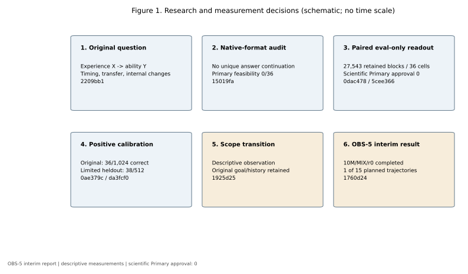
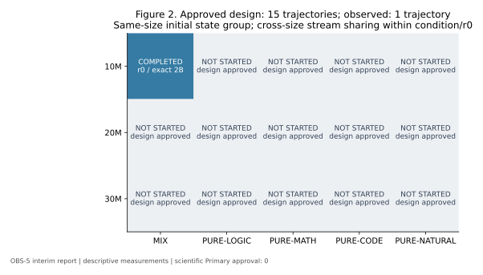
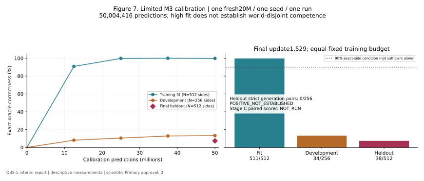
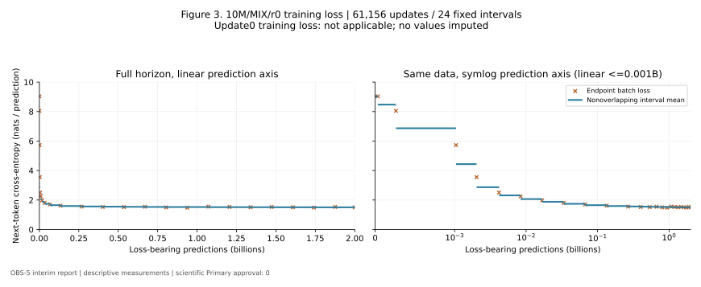
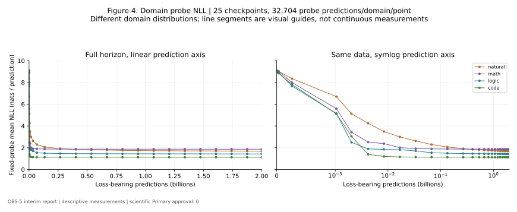
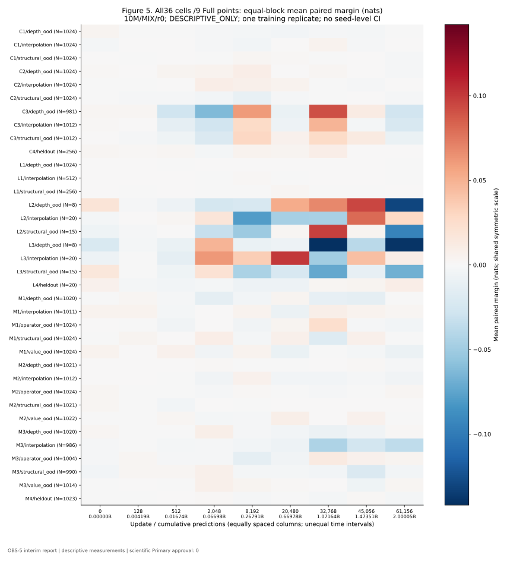
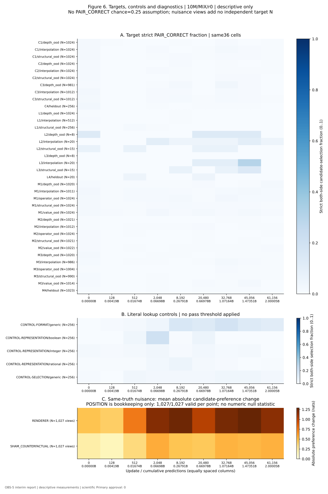

# Model v1：小型Transformerの学習過程と評価方法の限界
## OBS-5時点の記述的比較発達観察・中間技術報告

**PUBLIC_OBS5_INTERIM_REPORT — OBS-5時点の中間技術報告。**

対象はOBS-5終了時点。承認済み15 trajectoriesのうち、実行済みは**10M/MIX/r0の1本**。
本稿は研究全体の最終論文ではない。実施済みは1/15である。著者：**completenovice-eng**（認証済みGitHub login）。所属・実名は掲載しない。
重要な主張の出典・証拠水準は[claim audit](claim_audit.md)、
図の再計算は[Figure provenance](figures_and_reproduction.md)、公開条件は[確認表](../RELEASE_CHECKLIST.md)を参照。

## 1. 要旨

本研究は、小型decoder-only Transformerをscratchから育成し、学習経験Xが直接解答を教えていない
能力Yの形成にどう関わるかを調べる目的で開始した。データ生成、共有tokenizer、architecture、optimizer、
exact prediction会計と復旧の技術基盤を構築した一方、対象能力を測るreadoutの妥当性は十分確立できなかった。
Core Evalは27,543 paired blocks/36 cellsを保持するが、全cellsをDESCRIPTIVE_ONLY、科学的Primary承認を0とした。
[P01](claim_audit.md#p01) [P06](claim_audit.md#p06)

独立較正では20M RULE-POSITIVEの正答が36/1,024にとどまった。
限定M3でもtraining fit511/512に対してworld-disjoint heldout38/512、独立生成の両側正答0/256だった。
positive competenceが未成立のため、現行scorer感度について結論できなかった。
この経緯を残し、研究を記述的・探索的な比較発達観察へ移行した。
[P12](claim_audit.md#p12) [P16](claim_audit.md#p16) [P17](claim_audit.md#p17)

初回10M/MIX/r0は61,156 updates/2,000,045,824 loss-bearing predictionsを完走し、25 checkpointsと9 Full測定を保存した。
loss、probe NLL、候補選好、両側選択を別の観測量として報告する。
この結果から推論能力発現・能力不存在・機構因果・他条件への一般化は認定しない。
[P20](claim_audit.md#p20) [P27](claim_audit.md#p27)

## 2. 研究動機

小さいモデルを一から学習させることで、規模、経験するデータ、学習量、観測時点を明示的に制御し、
学習過程を比較する構想を立てた。実用的な小型言語モデルの最終性能を最大化することが主目的ではなかった。
ここで述べる動機はPhase0の研究目的に基づく。研究者の感情や個人的回想は補っていない。
[P01](claim_audit.md#p01)

## 3. 当初の研究問いと計画

当初は能力が形成される時期、size/domain差、訓練に含まれないdomainへの転移、内部表現・回路との対応を問うた。
5 discovery＋5 fresh confirmation、暫定4/5方向規則、行動・機構関連・因果のclaim区分を構想した。
具体architecture、precision、horizon、cadence、統計手続の多くは当初未確定だった。
後のOBSはこの確認的計画の達成ではなく、明示的なscope変更である。
[P01](claim_audit.md#p01) [P17](claim_audit.md#p17)



**Figure 1.** 当初構想→native監査→paired readout→較正未成立→scope変更→OBS-5の記録順。
箱の大きさは所要時間・効果量を表さない。詳しい採用・棄却理由は[公開用説明・要約（非公開原本に基づく）](../evidence/methods_and_history.md)に保持した。

## 4. 実験設計

最終観察designはPURE-LOGIC、PURE-MATH、PURE-CODE、PURE-NATURAL、MIXの5条件と10M/20M/30Mの3規模、
replicate0の15 trajectories。各exact2Bを共通とする。OBS-5実行許可は初回10M/MIX/r0だけで消費済み。
残14は未実行で、新しい研究者指示が必要である。
[P18](claim_audit.md#p18) [P28](claim_audit.md#p28)



**Figure 2.** 色は実行状態であり性能ではない。灰色14条件の結果は未取得。
同sizeではconditions間でinitial-state groupを共有し、同condition/r0ではsize間で同一token streamを使う。
15本を15独立model seedsとは数えない。

## 5. Model architectureとoptimization

GPT型causal decoder-only Transformer。6-layer pre-LN、通常MHA、head dimension64、FFN4×width、
exact GELU、dropout0、linear biasなし、affine LN（eps1e-5）、RoPE base10,000、tied embedding/output。
10M等は近似的なnonembedding scale labelであり、total parameter数ではない。
[P02](claim_audit.md#p02)

|Scale|Layers|Width|Heads|FFN|Nonembedding|Shared embedding/output|Total unique trainable|
|---|---:|---:|---:|---:|---:|---:|---:|
|10M|6|384|6|1536|10,626,816|3,145,728|13,772,544|
|20M|6|512|8|2048|18,887,680|4,194,304|23,081,984|
|30M|6|640|10|2560|29,507,840|5,242,880|34,750,720|

nonembeddingは共有8192×width行列だけを除きLNを含む。tied outputは二重加算しない。
共有SentencePiece Unigram8192、context512。本文をencodeしEOS1を外付けする。
連続packingで各512 positionsから511 shifted predictionsを取り、EOS・文書境界もloss対象。
silent truncation、PAD、BOS、domain別loss maskは用いない。

A2はAdamW、LR6e-4、betas(.9,.95)、eps1e-8、weight decay.1（全unique parameters）、clip1。
2,000,000 predictionsのlinear warmup後constant、full LRはupdate62。
effective batch64＝microbatch32×accumulation2、1 updateは32,704 predictions。
BF16 autocast、FP32 master/moments/loss、precision/backendの暗黙fallbackなし。
exact horizonは61,156×64×511＝2,000,045,824で、packed positions数とは異なる。
正本は[公開用説明・要約（非公開原本に基づく）](../evidence/source_notes.md#training-contract)。
[P02](claim_audit.md#p02)

## 6. Training dataとdistribution contracts

SyntheticのTRAINは各domain family1–3、family4はheldout。番号は難易度順ではない。
latent、renderer、oracle metadataを分離し、実TRAIN本文はrendered_problemのみ。
oracle answer completionを直接教えていないことは、oracle関連情報が皆無という意味ではない。
[P03](claim_audit.md#p03) [P09](claim_audit.md#p09)

|Domain|TRAIN family1–3|Family4（own-family TRAINなし）|
|---|---|---|
|Logic|state propagation / directed reachability / unary-rule propagation|set/inclusion|
|Math|exact arithmetic AST / dependency DAG / inverse-generated linear equation|affine composition|
|Code|straight state / conditional state / bounded loop|branch/loop composition|

NaturalはTinyStories-cleanの固定TRAIN KEEP poolとR1反復を使う。
epoch内はeligible documentsを一度ずつ固定permutationで並べ、epoch間反復を許す。
固定probe ID/bodyは永久除外する。Synthetic fresh-source policyはsource IDの再使用禁止であり、
有限support中の同latent world/bodyが二度と現れない保証ではない。
厳密なvalue/depth/renderer/rejection lawは[公開用説明・要約（非公開原本に基づく）](../evidence/source_notes.md#synthetic-support)を参照する。

MIXはNatural→Math→Logic→Codeのsequence単位交互配置。
各update16 sequences/domainでloss-bearing prediction share各25%。document件数比やIID domain抽選ではない。
init seedは`8164703693637831597`、stream seedは`17323835196105447590`。
後者はsigned64外のためdecimal stringから正確にPython intへ復元する。
共通seedは役割ごとのnamespaceとcondition identityに結びつける。
[P18](claim_audit.md#p18)

## 7. 再現性とLong-Horizon pilot

Architecture/optimizer候補のsmoke・throughput・robustness後、20MのMIX/PURE-LOGIC/PURE-NATURALを
0→2Bまでoptimization-only pilotとして監査した。
PURE-MATH/CODEや10M/30Mについて同じ2B直接監査を行ったとは言わない。
D3-Cにはhistorical SHA、stream/probe、resume照合の記録がある。これらは技術再現性の証拠であり、能力測定妥当性の承認ではない。
[P04](claim_audit.md#p04)

D3-A Naturalの中断・復旧も保存した。旧重複時点のprobe一致と全model/RNG一致は証拠範囲が異なる。
OBS-3/5のcontinuous/resume/evaluation-resume fixture比較もsoftware検証であり、実Mainでresume事故が起きた証拠ではない。
本稿作成ではhistorical weightsをloadせず、保存結果のみを読み取った。

## 8. Evaluation construction

Native-format continuation監査では、共通prefix後の双方が妥当な問題本文になり得た。
TRAINにoracle completionがなく、intended能力で一方をunique goldとする意味論を確立できず、native primary feasibilityは0/36だった。
[P05](claim_audit.md#p05)

eval-only candidate interface、label exposure監査、label-free original/counterfactual readoutを経て固定bankを構築した。
初版27,754 blocksから、15cellsの211 nested-answer blocksをwhole-block除去し27,543に修正した。
自然な代替foilの妥当性を確立できず除外を採用し、旧bankとscorerを保存した。
現bankは36 cells、controls1,280、negative diagnostics3,081。
construction PASSとscientific Primary approvalは別で、後者は0である。
[P06](claim_audit.md#p06)

### Fixed paired readout

同じA/Bを両contextで使用する。P0ではA=oracle/B=foil、P1ではA=foil/B=oracle：

```text
d0 = log p(A | P0) - log p(B | P0)
d1 = log p(A | P1) - log p(B | P1)
paired_margin = (d0 - d1) / 2
PAIR_CORRECT = (d0 > 0 AND d1 < 0)
```

continuation全tokenのsum log-likelihood、EOS非採点、length normalizationなし。
whole-string tokenizationがprefix境界を保つことを確認し、token iをlogit i−1で採点する。
side tieは0.5、strict pair tieは不正答。cell内equal-block meanで集約し、全cellの単一能力点を作らない。
正本実装は非公開であり、測定定義は[公開用説明・要約（非公開原本に基づく）](../evidence/readout_contract.md)。
[P07](claim_audit.md#p07)

## 9. Construct validityと較正上の問題

正の平均marginは両側正答と異なる。両promptでAを好んでも、P0のA選好がより強ければmarginは正になる。
exp(2m)はcandidate likelihood-ratioのcontext間の比であり正答確率ではない。
固定candidate priorは相殺できても、prompt-dependent lexical/length/editing interactionは残る。
related promptsの判定は独立と仮定できず、PAIR_CORRECTのchanceを無条件に25%としない。
joint sign-exchangeabilityも未証明で、item randomization p値を主張の必須条件へ戻していない。

13,319 unequal-token-length blocksを保持している。equal subsetだけを使うとlatent分布が変わる。
単純local/numeric shortcutsの高成績例とliteral lookup controlsの限界を認める。
M3のRHS予測圧力は逆問題を解く能力と同一でない。
[P08](claim_audit.md#p08) [P09](claim_audit.md#p09)

M3/interpolationではCF569/986の解がTRAIN抽選範囲外とpreflightで判明した。
較正は両側supportの別poolを使ったが、既存bankの問題を修復した扱いにはしない。
M1/M2/M3 value_oodはMIXED_SUPPORT_SHIFTで、strict OODと一律同一視しない。
[P10](claim_audit.md#p10)

## 10. Negative calibration results

### 原E2-C3

ZERO-UPDATE、INTERFACE_ONLY、RULE_POSITIVE、DEPENDENCY_BROKENを事前設計した。
実行はfresh20M/one independent replicate、B/Cは同initial stateから分岐。
各1,529updates/50,004,416 predictions。Positiveを名前だけで認定せず、world-disjoint独立生成を先に要求した。
基準はexact sides≥90%、strict both-side≥80% overall/各必須conflict、overall≥256blocks、stratum≥64。
[P11](claim_audit.md#p11)

|Arm|独立正答 sides|Canonical rational format|独立生成strict pairs|Sealed mean margin|Sealed candidate PAIR_CORRECT|
|---|---:|---:|---:|---:|---:|
|INTERFACE_ONLY|1/1,024|44/1,024|0/512|−0.007735578|18/512|
|RULE_POSITIVE|36/1,024|1,018/1,024|0/512|0.240901128|34/512|

RULE_POSITIVEの形式正答と内容正答は大きく分かれた。正mean/gainだけで較正PASSしない。
両armはrequired controlsが不成立でINTERFACE_CONFOUNDED。
Positive未成立のstopによりDEPENDENCY_BROKEN、M1、追加seed、optional direct-interfaceは未実行。
negative specificityも確立していない。
[P12](claim_audit.md#p12) [P13](claim_audit.md#p13)

保存証拠の診断では4,756,841 answer-content loss targetsを確認し、oracle/offset/mask/parserの整合を監査した。
しかしanswer-position loss・training-fit生成・intermediate独立生成が未保存で、失敗原因は一意に同定できなかった。
教師信号の存在を十分な規則学習の証明としない。
[P14](claim_audit.md#p14) [P31](claim_audit.md#p31)

### 限定M3

同じ逆問題constructを保持し、a*x0+b=r、|a|2–9、nonzero |b|1–9、x−9..9、canonical add/mul、AST depth2へ限定した。
one fresh20M/one seed/one run、同50,004,416 predictions。fit/dev/heldout/pairedはworld単位で隔離した。
[P15](claim_audit.md#p15)

最終training fit511/512、development34/256、world-disjoint heldout38/512。
heldout canonical outputs499/512、独立生成strict both-side0/256、各必須surface-conflictもstrict0だった。
高fitが未見worldでのpositive competenceを保証しなかった。Stage B不成立のためStage CはNOT_RUN。
**0/256をpaired scorerの失敗と呼ばない。** 単純暗記だけという原因も確定していない。
[P16](claim_audit.md#p16)



**Figure 7.** 事前固定checkpointのfit/devと、terminalのみ開封したheldout。
縦軸はexact correctness、独立生成の指標。90%線だけでpositive成立せず、strict pairs/conflict条件も必要。
原C3と異なる限定分布なので性能差を学習量だけに帰属しない。

## 11. 記述的観察への移行

OBS-0で、当初能力研究の履歴を維持したまま、記述的・探索的比較発達観察へscopeを変更した。
技術資産と固定readoutを使い、optimizationと条件付き候補選好の変化を記録する。
測定仕様freezeは測定器の科学的妥当性承認ではない。
全36cells DESCRIPTIVE_ONLY、Primary0、positive calibration未成立を維持する。
[P17](claim_audit.md#p17)

## 12. Main Observation protocol

初回20M/MIX提案はOBS-2で研究者がsmall-first理由により10M/MIXへ変更した。結果による選別ではない。
Main Observation freeze tagは`model-v1-main-observation-v1-freeze`、commitは
`428faac777e64f2e81cc3f631447e905fbad06b0`。
旧manifestの`execution_authorized=false`は当時の提案記録で、OBS-5の明示承認overlayと分ける。
[P18](claim_audit.md#p18) [P26](claim_audit.md#p26)

25checkpoint updates（0とendpointを含む）：

```text
0,1,8,32,62,128,256,512,1024,2048,4096,8192,12288,
16384,20480,24576,28672,32768,36864,40960,45056,49152,53248,57344,61156
```

9 Full updates：`0,128,512,2048,8192,20480,32768,45056,61156`。Fastなし。
観測は固定時点の離散系列で、結果に応じてcheckpointを追加しない。
旧T_signal/T10/T50/T90や4/5則を本観察へ流用しない。
[P19](claim_audit.md#p19)

## 13. OBS-5：10M/MIX/r0の結果

新規初期化から61,156updates/2,000,045,824 predictionsを完走。
Natural/Math/Logic/Code各500,011,456 predictions、各25%。
25checkpoints、9 Fullで各27,543target blocks/1,280controls/3,081diagnosticsを保存した。
全61,156 consumed batch fingerprintsのplanned ledger照合はOBS-5独立verifierで一致したと記録され、H1が保存値を再集計した。
本P1で全stream replayやcheckpoint loadを再実行したとは言わない。
[P20](claim_audit.md#p20)

### 13.1 Training lossとprobe NLL

endpoint batch training lossはupdate1の9.035449からupdate61,156の1.501436へ変化した。
最後の3,812updatesのmeanは1.505934。update0にはtraining lossがない。
固定probeは各domain32,704 predictions/point、25pointsで、最終NLLは下表のとおり。
NLLは分布ごとの平均next-token負log-likelihoodであり、域間の低さを能力順位とは解釈しない。
[P21](claim_audit.md#p21)

|Domain probe|Update0 NLL|Update61,156 NLL|単位|
|---|---:|---:|---|
|Natural|9.065494|1.687666|nats/prediction|
|Math|9.114807|1.863457|nats/prediction|
|Logic|9.043418|1.432293|nats/prediction|
|Code|8.934153|1.128902|nats/prediction|



**Figure 3.** 全61,156updatesを覆う24個の固定checkpoint区間meanとendpoint batch loss。
左右は同じデータのlinear/symlog prediction軸。独立能力評価ではなくobjective telemetry。



**Figure 4.** 保存済み25時点のprobe metrics。線は視覚的補助で連続観測を意味しない。
per-token logitsは保存されておらず、元forwardのNLLを新しく独立計算したものではない。

### 13.2 Fixed bankの測定

全36cells×9pointsを以下に示す。各cellでblock等重みのmean、strict PAIR_CORRECTとstrataを保持した。
小bankと大bankを同じ検出感度と扱わず、cell間総合能力点やseed-level CIを構成しない。
[P22](claim_audit.md#p22)



**Figure 5.** 全cells、全時点、単一の0中心対称color scale。行ごとのnormalizationやcell選抜なし。
横列は等間隔表示だが実際のprediction間隔は不均等。色は固定bank選好であり能力発現ではない。



**Figure 6.** Aは全36cellsのstrict candidate PAIR_CORRECT、Bはlookup controls、Cはsame-truth nuisanceの絶対preference変化。
POSITIONはbookkeepingの整合検査で、0のnull statisticを代入していない。
controlsはrule理解を証明せず、diagnostic viewsは独立target Nを増やさない。
全数値は[公開用派生CSV](../data/cell_trajectories.csv)と[controls](../data/interface_controls.csv)/[diagnostics](../data/negative_diagnostics.csv)を参照。
[P23](claim_audit.md#p23)

### 13.3 Overlap、運用、資源

TRAIN/Core Eval overlap projectionはtarget body1,944/world7,507/diagnostic body192 member matchesを含む。
source ID/qualified source IDとexact eval-prefix/completion一致0は内容未見保証と異なる。
重複によるbankの事後除外は行っていない。
[P24](claim_audit.md#p24)

runtime stage clockは12,720.112s、launch-to-exitは12,817.048s、9 Full合計868.924s。
25checkpoint files計4,225,593,932 bytes、run rootは当時5.2GiB。
GPU-active時間は未計測で、wall clockをkernel-active時間とは呼ばない。
初回cap12hと全15本cap180hは承認予算であり、未実行14本の実測時間ではない。
[P25](claim_audit.md#p25)

2件のpre-initialization排他衝突と同値性checked receipt shimを履歴に残した。
第2件はevent hook前の停止で、独立したHARDSTOP eventが2件あると書かない。
科学的条件や成績に基づく再試行ではなかったという記録を、証拠水準REPORTED_ONLYで保持する。
[P26](claim_audit.md#p26)

## 14. 限界とnegative resultsの扱い

当初目標である能力形成・一般化・内部機構の科学的確証は得ていない。
loss低下を規則獲得、低scoreを能力不存在、内部相関を因果、one seedをモデル一般へ拡張しない。
不明な原因を「暗記」として埋めず、scorer感度未確認とscorer欠陥確定を分ける。
[P27](claim_audit.md#p27) [P31](claim_audit.md#p31)

H2 negative records14件を省略せず、公開上の位置を以下に対応づけた。

|H2 ID|未成立・制限|本文対応|
|---|---|---|
|N01|native gold construct|§8|
|N02|label exposure neutrality未実証|§8、H2原本|
|N03|joint sign-exchangeability未証明|§9|
|N04|nested-answer211除外|§8|
|N05|length/shortcut/lookup controls|§9/13.2|
|N06|M3 CF support|§9|
|N07|原C3 positive未成立・negative未完|§10|
|N08|原C3原因未同定/未保存量|§10|
|N09|限定fit/heldoutの分離|§10/Figure7|
|N10|限定StageC未実行|§10|
|N11|D3-A技術中断・復旧の証拠範囲|§7|
|N12|OBS3容量/seed gate→OBS4固定index|§15/§18|
|N13|OBS5 pre-init衝突|§13.3|
|N14|元研究目標未達/比較1/15|§1/14/16|

## 15. 再現性手順（図表・文書のみ）

本稿の図表は公開集計から再生成できる。非公開の原本、元GPU実験、raw応答までの独立再検証はこのsubsetだけではできない。学習runnerやモデル評価は必要ない。
repository rootで、production環境と別のplot用venvに
[固定plot dependencies](../requirements.txt)を導入し、次を実行する。

```sh
python scripts/reproduce_figures.py --output ../reproduced-figures
python scripts/audit_public_export.py --root .
```

公開CSVは図表に必要な集計subsetであり、含めた表の数値文字列は変更していない。H1のsource/source_key列と、図が使わない長さ層別表・raw応答は含めない。
限定較正は保存execution manifestのtrajectory/stage_Bから転記する。SHAと方法はFigure provenanceに記録した。
図のexact-byte再現には固定plot package versionsと描画環境が必要で、異versionでは数値と画像SHAを分けて確認する。

Model checkpoint、raw story、prepared2B streamを本原稿に同梱していない。
元の全実験再現を公開用小CSVだけで可能とは主張しない。
OBS4のsource index共有・固定長化はTRAIN lawを変えない運用改善で、全2B auditは当時のreceiptを継承する。
再配布範囲とrepository historyの公開可否は別gate。
[P30](claim_audit.md#p30)

## 16. Future work

残14は条件design承認済みだが実行未許可。指定trajectoryごとにstream/overlap/capacity/bindingの起動gateと
研究者の新しい実行指示が必要である。完了後に同じ記述的scopeでsize/domain比較を行う予定とする。
追加seed、較正、Core Eval改訂、機構因果実験、公開そのものは自動開始しない。
[P28](claim_audit.md#p28)

## 17. 参考文献・AI利用

Phase0の体系的参考文献一覧は原本から確認できなかった。
以下は**P1で書誌確認した技術背景文献**であり、全てを当初の発想源として遡及帰属しない。
先行研究の評価成績・architecture全体を本実装の実績として移用しない。

1. Ashish Vaswani, Noam Shazeer, Niki Parmar, Jakob Uszkoreit, Llion Jones, Aidan N. Gomez, Lukasz Kaiser, Illia Polosukhin (2017). [Attention Is All You Need](https://arxiv.org/abs/1706.03762). arXiv:1706.03762. Transformerの背景。本実装はdecoder-only。
2. Ilya Loshchilov, Frank Hutter (2017 preprint; ICLR 2019). [Decoupled Weight Decay Regularization](https://arxiv.org/abs/1711.05101). arXiv:1711.05101. AdamWの背景。A2数値は本研究の契約。
3. Jianlin Su, Yu Lu, Shengfeng Pan, Ahmed Murtadha, Bo Wen, Yunfeng Liu (2021 preprint; v5:2023). [RoFormer: Enhanced Transformer with Rotary Position Embedding](https://arxiv.org/abs/2104.09864). arXiv:2104.09864. RoPEの背景。RoFormer全体の再現ではない。
4. Taku Kudo, John Richardson (2018). [SentencePiece: A simple and language independent subword tokenizer and detokenizer for Neural Text Processing](https://aclanthology.org/D18-2012/). EMNLP System Demonstrations, D18-2012. 共有tokenizer softwareの背景。
5. Ronen Eldan, Yuanzhi Li (2023). [TinyStories: How Small Can Language Models Be and Still Speak Coherent English?](https://arxiv.org/abs/2305.07759). arXiv:2305.07759. Natural corpusの出典。論文の生成評価法や能力主張を本研究で再現したとは言わない。

AIは設計支援、コード実装、検証支援、文書整理に関与した。研究者が目的・scope・実行の最終判断を行った。
外部AIレビュー後に見直した記録はあるが、原文や担当別の全貢献は未確認で、人間の外部査読/peer reviewとは呼ばない。
AI意見、Codex実装、software検証、保存実測値を分ける。著者・AI支援の確認範囲は[AUTHORS](../AUTHORS.md)に記載した。未確認の担当別貢献は補完しない。
[P29](claim_audit.md#p29)

## 18. Artifact indexと公開範囲

|資料|版・参照|状態|
|---|---|---|
|OBS5実行原本|`1760d2481c9f09f55d2a99dc7280821a6b3a1c92` / [公開用説明・要約（非公開原本に基づく）](../evidence/source_notes.md#obs5-execution)|保存記録|
|Main Observation仕様|`428faac777e64f2e81cc3f631447e905fbad06b0` / [公開用説明・要約（非公開原本に基づく）](../evidence/source_notes.md#observation-freeze)|仕様freeze、科学承認ではない|
|H1|`e058413e125bdf770c5a75c8c5e6f64638e409dc` / [公開用説明・要約（非公開原本に基づく）](../data/cell_trajectories.csv)|raw由来集計|
|H2|`62e62f98df8244255eceb45f3776a54083d67734` / [公開用説明・要約（非公開原本に基づく）](../evidence/source_notes.md)|証拠水準と未解明を保持|
|P1公開候補図・CSV|[inventory](../evidence/export_manifest.json)|OBS-5中間報告、local pathを除去した派生物|

歴史的原本は非公開のまま維持し、リンクは公開用の説明・集計へ置換した。元資料SHAとcommitの識別情報は、第三者がその内容を入手・検証できる保証ではない。
研究者が権利を持つ本文・図表・集計はCC BY 4.0、独自公開scriptはMITとする。[適用表](../licensing/SCOPE.json)で第三者資産を除外する。研究者によるGitHub外部公開承認に基づく公開版。
公開先：[small-transformer-model-v1](https://github.com/completenovice-eng/small-transformer-model-v1)。note投稿は別工程とする。

## Appendix A. 全36cellの0-updateと終点（記述値）

All9 points are in the linked CSV/Figures5–6. Fractionはstrict PAIR_CORRECT。小bankを大bankと同じ感度とは扱わない。
[P22](claim_audit.md#p22)

|Cell|N blocks|Mean m at0|Mean m at61,156|PAIR_CORRECT at0|PAIR_CORRECT at61,156|
|---|---:|---:|---:|---:|---:|
|C1/depth_ood|1024|0.003683|-0.000488|23/1024|5/1024|
|C1/interpolation|1024|-0.003211|0.000612|21/1024|5/1024|
|C1/structural_ood|1024|0.000484|-0.001971|23/1024|4/1024|
|C2/depth_ood|1024|0.001429|-0.001150|12/1024|5/1024|
|C2/interpolation|1024|-0.000022|0.000214|14/1024|7/1024|
|C2/structural_ood|1024|-0.000940|-0.001177|12/1024|0/1024|
|C3/depth_ood|981|0.002954|-0.027329|10/981|3/981|
|C3/interpolation|1012|0.001132|-0.023168|26/1012|2/1012|
|C3/structural_ood|1012|0.000359|-0.009061|19/1012|5/1012|
|C4/heldout|256|0.002470|0.000807|7/256|0/256|
|L1/depth_ood|1024|0.000112|-0.001045|7/1024|0/1024|
|L1/interpolation|512|0.000608|-0.000359|4/512|1/512|
|L1/structural_ood|256|0.000594|0.000366|1/256|0/256|
|L2/depth_ood|8|0.018026|-0.130859|1/8|0/8|
|L2/interpolation|20|-0.002839|0.028516|0/20|1/20|
|L2/structural_ood|15|-0.005565|-0.094531|1/15|0/15|
|L3/depth_ood|8|-0.021093|-0.138672|0/8|0/8|
|L3/interpolation|20|-0.007663|0.009570|0/20|0/20|
|L3/structural_ood|15|0.016010|-0.068750|0/15|0/15|
|L4/heldout|20|0.006651|0.009375|0/20|0/20|
|M1/depth_ood|1020|-0.000512|-0.000267|13/1020|16/1020|
|M1/interpolation|1011|0.004841|0.003260|24/1011|15/1011|
|M1/operator_ood|1024|0.000147|-0.003545|23/1024|14/1024|
|M1/structural_ood|1024|-0.000640|-0.001061|22/1024|4/1024|
|M1/value_ood|1024|0.005015|-0.008052|23/1024|9/1024|
|M2/depth_ood|1021|0.000463|-0.001930|7/1021|2/1021|
|M2/interpolation|1012|0.000171|-0.005013|7/1012|4/1012|
|M2/operator_ood|1024|0.002581|0.002620|11/1024|5/1024|
|M2/structural_ood|1021|0.002736|0.000648|11/1021|3/1021|
|M2/value_ood|1022|-0.001043|-0.000569|10/1022|8/1022|
|M3/depth_ood|1020|0.002720|0.001675|16/1020|7/1020|
|M3/interpolation|986|-0.002129|-0.036382|13/986|7/986|
|M3/operator_ood|1004|-0.001526|0.003469|5/1004|4/1004|
|M3/structural_ood|990|-0.003919|-0.003827|15/990|5/990|
|M3/value_ood|1014|-0.001028|0.002463|10/1014|3/1014|
|M4/heldout|1023|-0.000348|-0.002250|5/1023|3/1023|


## Public exportの検証範囲

公開集計で図表を再計算するA、訓練全体を再実行するB、非公開raw evidenceを独立検証するCは別である。本subsetが実証するのはAのみ。公開用説明は原本そのものではなく、非公開報告の要約と証拠水準を保持した派生物である。
